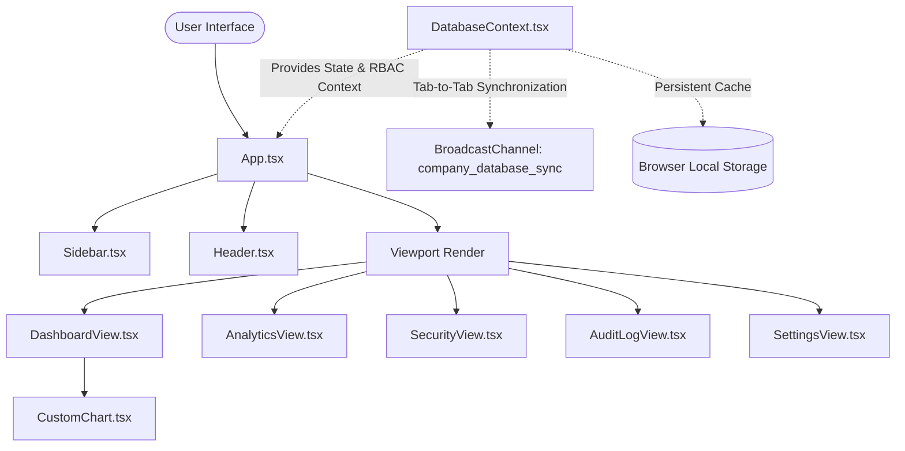

# DataSphere System Architecture & Feature Documentation

DataSphere is an interactive, premium Enterprise Business Intelligence (BI) dashboard and cybersecurity simulation deck. It showcases real-time mock data synchronization, custom canvasless vector charting, granular Role-Based Access Control (RBAC), and interactive web vulnerability simulation triggers.

---

## 1. Project Overview & Architecture

DataSphere is built on top of **React 19**, **TypeScript**, and **Vite**. Instead of loading large external libraries, the project emphasizes lightweight, robust, and hand-crafted utilities, such as a custom responsive SVG graphing component and a native browser tab-to-tab sync mechanism.

### System Architecture Diagram



### Directory Structure

The project has a highly modular structure:

*   **`src/`**: Parent directory containing all core code.
    *   [App.tsx](file:///F:/MyCodings/FullStack/DataSphere/src/App.tsx): Root layout viewport and component switchboard.
    *   [index.css](file:///F:/MyCodings/FullStack/DataSphere/src/index.css): Core styling sheet containing variables, grid definitions, cyber-glow animations, and a Tailwind-mimicking custom utility framework.
    *   **`components/`**: Interactive UI fragments.
        *   [DashboardView.tsx](file:///F:/MyCodings/FullStack/DataSphere/src/components/DashboardView.tsx): Displays metrics cards, real-time node statistics ticker, and trend graphs.
        *   [AnalyticsView.tsx](file:///F:/MyCodings/FullStack/DataSphere/src/components/AnalyticsView.tsx): Provides metric search, sort, and CRUD actions guarded by permissions and anti-CSRF check.
        *   [SecurityView.tsx](file:///F:/MyCodings/FullStack/DataSphere/src/components/SecurityView.tsx): Interactive playground to enable/disable security patches and trigger exploit simulations.
        *   [AuditLogView.tsx](file:///F:/MyCodings/FullStack/DataSphere/src/components/AuditLogView.tsx): System action logger page (restricted to administrators).
        *   [SettingsView.tsx](file:///F:/MyCodings/FullStack/DataSphere/src/components/SettingsView.tsx): Displays active role privileges list, sync latency configuration, and cache tools.
        *   [CustomChart.tsx](file:///F:/MyCodings/FullStack/DataSphere/src/components/CustomChart.tsx): Responsive vector SVG-renderer for Area, Line, and Bar charts.
        *   [Sidebar.tsx](file:///F:/MyCodings/FullStack/DataSphere/src/components/Sidebar.tsx): Left drawer navigation with database connection telemetry.
        *   [Header.tsx](file:///F:/MyCodings/FullStack/DataSphere/src/components/Header.tsx): Header banner containing global switches for user switching and rotating tokens.
    *   **`context/`**: Global state provider.
        *   [DatabaseContext.tsx](file:///F:/MyCodings/FullStack/DataSphere/src/context/DatabaseContext.tsx): Manages metrics arrays, audit logs list, defense settings, inputs sanitizers, and connection protocols.
    *   **`types/`**:
        *   [index.ts](file:///F:/MyCodings/FullStack/DataSphere/src/types/index.ts): Holds TypeScript types and interface models (e.g. `User`, `MetricData`, `AuditLog`, `ExploitAttempt`).

---

## 2. Key Features

### 📡 Real-Time Multi-Tab Synchronization (`BroadcastChannel`)
The application implements state replication across multiple browser instances.
*   **Mechanism**: Powered by the browser's native `BroadcastChannel` API.
*   **Behavior**: When a user updates, adds, or deletes a metric in one tab, a channel transmission (`company_database_sync`) is broadcast to other open tabs.
*   **Network Simulation**: Simulates network latency (randomly between `10ms` and `40ms`) when syncing.
*   **Ticker telemetry**: Toggles status between `SYNCING` and `PAUSED` using `isRealtimeActive`.

### 📊 Customized Vector Charting (`CustomChart`)
Data values are rendered using SVGs rather than relying on bloated canvas plotting libraries.
*   **Graphics Types**: Area, Line, and Bar layouts.
*   **Responsive Scaling**: Wrapped in a `ResizeObserver` listener that dynamically tracks the pixel width of the grid container and re-maps coordinates instantly.
*   **Interactions**: Includes mouse tracking and pixel-hover calculations that display context tooltips pointing to chronological values (e.g., historical metric updates).

---

## 3. Role-Based Access Control (RBAC)

The application enforces security checks at the data model level in [DatabaseContext.tsx](file:///F:/MyCodings/FullStack/DataSphere/src/context/DatabaseContext.tsx). The global context exposes three main contexts:

| Privilege / Action | Admin (`admin`) | Manager (`manager`) | Viewer (`viewer`) |
| :--- | :---: | :---: | :---: |
| **View Dashboard Indicators** | ✅ Yes | ✅ Yes | ✅ Yes |
| **Create New Metric Indicators** | ✅ Yes | ✅ Yes | ❌ Blocked |
| **Update Existing Metrics** | ✅ Yes | ✅ Yes | ❌ Blocked |
| **Full Metric Deletion Rights** | ✅ Yes | ❌ Blocked | ❌ Blocked |
| **Inspect System Audit Logs** | ✅ Yes | ❌ Blocked | ❌ Blocked |
| **Modify Global Security Shields** | ✅ Yes | ❌ Blocked | ❌ Blocked |

> [!WARNING]
> If a `viewer` or `manager` attempts to perform an unauthorized action (e.g., clicking on the *Audit Logs* section or calling a mutation function), the system blocks the execution, logs the breach to the audit log trail, and displays a red **ACCESS VIOLATION** terminal overlay showing client details (simulated IP and current context role).

---

## 4. Interactive Security Hub (Exploit Sandbox)

The **Security Hub** enables developers to simulate common web attack vectors and see how defensive security layers protect a database. Users can toggle four security shields on or off:

```
[Shield Switch Status] ──> [Simulate Exploit Trigger] ──> [Database Engine Validation]
                                                                  │
                                      ┌───────────────────────────┴───────────────────────────┐
                             (Shield Enabled / Patched)                              (Shield Disabled / Unpatched)
                                      ▼                                                       ▼
                       - Input sanitized or request blocked.                   - Malicious injection saved to DB.
                       - Attack logged as 'Sanitized' or 'Blocked'.            - Vulnerability executes or changes state.
```

### Exploit & Shield Specifications

#### 1. Cross-Site Scripting (XSS)
*   **Mechanism**: The input scanner screens incoming text for script strings (`<script>`, `javascript:`, `onerror=`, etc.).
*   **If Patched (Shield On)**: The application sanitizes the input by stripping script elements before committing writes to `localStorage`.
*   **If Unpatched (Shield Off)**: The system writes raw HTML/JavaScript tags directly to the metric's name.

#### 2. SQL Injection (SQLi)
*   **Mechanism**: Searches database writes for structural SQL query patterns (e.g. `' OR 1=1`, `DROP TABLE`, `UNION SELECT`).
*   **If Patched (Shield On)**: Rejects dangerous syntax or strips characters, returning a transaction rollback database exception.
*   **If Unpatched (Shield Off)**: Saves structured SQL parameters directly into the schema.

#### 3. Cross-Site Request Forgery (CSRF)
*   **Mechanism**: Requires that all write queries contain a cryptographic challenge-response token matching the server's session token.
*   **If Patched (Shield On)**: Rejects requests with mismatched tokens and logs a CSRF violation. Tokens are auto-rotated on successful writes.
*   **If Unpatched (Shield Off)**: Skips verification, allowing arbitrary updates.

#### 4. Rate Limiting (Token Bucket)
*   **Mechanism**: Limits write access (add, edit, delete) to a maximum of **5 transactions per 10 seconds** per client.
*   **If Patched (Shield On)**: If exceeded, locks write access for `8s`, returning `HTTP 429 Too Many Requests`.
*   **If Unpatched (Shield Off)**: Allows unlimited rapid writes (open to DDoS and brute-force simulations).

---

## 5. Local Setup & Running Instructions

To run DataSphere locally, execute the following steps in your terminal:

1.  **Install dependencies**:
    ```bash
    npm install
    ```
2.  **Start development server**:
    ```bash
    npm run dev
    ```
3.  **Build production package**:
    ```bash
    npm run build
    ```
4.  **Preview production build locally**:
    ```bash
    npm run preview
    ```

> [!TIP]
> To test **tab synchronization**, open two separate browser windows at `http://localhost:5173`. Modify a metric value in one tab, and watch the changes apply automatically in the other window.
