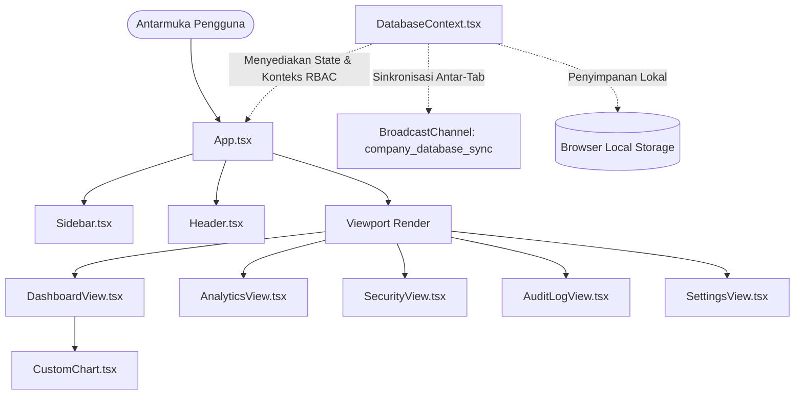

# Arsitektur Sistem & Dokumentasi Fitur DataSphere

DataSphere adalah dasbor *Enterprise Business Intelligence (BI)* interaktif dan platform simulasi keamanan siber premium. Aplikasi ini menampilkan sinkronisasi data *real-time* multi-tab, visualisasi grafik vektor SVG tanpa pustaka pihak ketiga (*canvasless charting*), Kontrol Akses Berbasis Peran (*Role-Based Access Control* / RBAC), serta modul simulasi eksploitasi kerentanan keamanan web secara langsung.

---

## 1. Ikhtisar & Arsitektur Proyek

DataSphere dibangun menggunakan **React 19**, **TypeScript**, dan **Vite**. Proyek ini menekankan efisiensi dengan tidak menggunakan pustaka grafik eksternal yang berat, melainkan menggunakan komponen penampil grafik SVG responsif buatan sendiri serta mekanisme sinkronisasi data antar-tab peramban bawaan.

### Diagram Arsitektur Sistem



### Struktur Direktori

Proyek ini menggunakan struktur modular yang rapi:

*   **`src/`**: Direktori utama kode sumber aplikasi.
    *   [App.tsx](file:///F:/MyCodings/FullStack/DataSphere/src/App.tsx): Komponen utama yang mengatur tata letak dan peralihan tampilan halaman.
    *   [index.css](file:///F:/MyCodings/FullStack/DataSphere/src/index.css): Berisi definisi variabel CSS, tata letak, efek visual/animasi *glowing*, serta kerangka utilitas bergaya Tailwind.
    *   **`components/`**: Berisi modul antarmuka pengguna (UI).
        *   [DashboardView.tsx](file:///F:/MyCodings/FullStack/DataSphere/src/components/DashboardView.tsx): Menampilkan indikator kinerja utama (KPI), telemetri latensi, dan grafik tren data.
        *   [AnalyticsView.tsx](file:///F:/MyCodings/FullStack/DataSphere/src/components/AnalyticsView.tsx): Menyediakan antarmuka untuk pencarian, pengurutan, serta operasi CRUD metrik yang dilindungi oleh token anti-CSRF dan pemeriksaan peran pengguna.
        *   [SecurityView.tsx](file:///F:/MyCodings/FullStack/DataSphere/src/components/SecurityView.tsx): Pusat simulasi keamanan di mana pengguna dapat mengaktifkan/menonaktifkan filter keamanan dan mencoba melancarkan simulasi serangan siber.
        *   [AuditLogView.tsx](file:///F:/MyCodings/FullStack/DataSphere/src/components/AuditLogView.tsx): Halaman log audit aktivitas sistem (hanya dapat diakses oleh administrator).
        *   [SettingsView.tsx](file:///F:/MyCodings/FullStack/DataSphere/src/components/SettingsView.tsx): Menampilkan tabel hak akses RBAC, konfigurasi latensi sinkronisasi, dan tombol hapus tembolok (*cache*).
        *   [CustomChart.tsx](file:///F:/MyCodings/FullStack/DataSphere/src/components/CustomChart.tsx): Komponen grafik SVG responsif buatan sendiri untuk tipe Area, Garis (Line), dan Batang (Bar).
        *   [Sidebar.tsx](file:///F:/MyCodings/FullStack/DataSphere/src/components/Sidebar.tsx): Bilah navigasi samping yang dilengkapi dengan telemetri koneksi database.
        *   [Header.tsx](file:///F:/MyCodings/FullStack/DataSphere/src/components/Header.tsx): Bilah atas yang berisi informasi token CSRF aktif, peringatan pembatasan laju (*rate limit*), dan pilihan ganti peran siber secara cepat.
    *   **`context/`**: Pengelola status (*state*) global.
        *   [DatabaseContext.tsx](file:///F:/MyCodings/FullStack/DataSphere/src/context/DatabaseContext.tsx): Mengelola status metrik, riwayat log audit, konfigurasi keamanan, sanitasi masukan, dan alur sinkronisasi.
    *   **`types/`**:
        *   [index.ts](file:///F:/MyCodings/FullStack/DataSphere/src/types/index.ts): Menampung definisi antarmuka dan tipe TypeScript (misalnya `User`, `MetricData`, `AuditLog`, `ExploitAttempt`).

---

## 2. Fitur Unggulan

### 📡 Sinkronisasi Lintas Tab Real-Time (`BroadcastChannel`)
Aplikasi ini mendukung sinkronisasi status data secara langsung di antara beberapa tab peramban yang terbuka sekaligus.
*   **Mekanisme**: Memanfaatkan API bawaan peramban `BroadcastChannel`.
*   **Perilaku**: Setiap kali pengguna menambah, mengedit, atau menghapus metrik di satu tab, pembaruan akan disiarkan melalui saluran `company_database_sync` ke tab lainnya.
*   **Simulasi Jaringan**: Latensi transmisi data disimulasikan secara acak antara `10ms` hingga `40ms` untuk mensimulasikan koneksi jaringan dunia nyata.
*   **Status Telemetri**: Status dapat dijeda atau dilanjutkan melalui konfigurasi `isRealtimeActive`.

### 📊 Visualisasi Grafik SVG Mandiri (`CustomChart`)
Data historis divisualisasikan tanpa menggunakan pustaka grafik pihak ketiga yang berat.
*   **Tipe Grafik**: Mendukung format Area, Garis (Line), dan Batang (Bar).
*   **Skala Responsif**: Menggunakan pemantau `ResizeObserver` untuk mendeteksi perubahan lebar wadah piksel secara dinamis dan memetakan ulang koordinat grafik secara instan.
*   **Interaktivitas**: Dilengkapi dengan kalkulasi posisi kursor (*hover tooltip*) untuk menampilkan informasi titik data historis secara mendetail.

---

## 3. Kontrol Akses Berbasis Peran (RBAC)

Aplikasi ini menegakkan validasi hak akses secara ketat langsung pada lapisan manipulasi data di [DatabaseContext.tsx](file:///F:/MyCodings/FullStack/DataSphere/src/context/DatabaseContext.tsx):

| Tindakan / Operasi | Admin (`admin`) | Manajer (`manager`) | Pengunjung (`viewer`) |
| :--- | :---: | :---: | :---: |
| **Melihat Dasbor Indikator** | ✅ Diizinkan | ✅ Diizinkan | ✅ Diizinkan |
| **Membuat Indikator Metrik Baru** | ✅ Diizinkan | ✅ Diizinkan | ❌ Ditolak |
| **Mengedit Nilai Metrik Aktif** | ✅ Diizinkan | ✅ Diizinkan | ❌ Ditolak |
| **Menghapus Metrik dari Sistem** | ✅ Diizinkan | ❌ Ditolak | ❌ Ditolak |
| **Memeriksa Log Audit Sistem** | ✅ Diizinkan | ❌ Ditolak | ❌ Ditolak |
| **Mengubah Konfigurasi Pertahanan Siber** | ✅ Diizinkan | ❌ Ditolak | ❌ Ditolak |

> [!WARNING]
> Ketika pengguna dengan peran `viewer` atau `manager` mencoba melakukan tindakan terlarang (seperti membuka tab *Audit Logs* atau memicu penulisan ilegal), sistem akan menolak perintah tersebut, mencatat upaya pelanggaran ke database log audit, dan memicu tampilan layar **ACCESS VIOLATION** berwarna merah dengan rincian data klien (alamat IP simulasi dan peran).

---

## 4. Pusat Simulasi Keamanan (Security Playground)

Halaman **Security Hub** dirancang sebagai tempat bereksperimen dengan kerentanan keamanan web standar. Pengguna dapat menonaktifkan pelindung (*shield*) tertentu untuk melihat bagaimana serangan bekerja, lalu mengaktifkannya kembali untuk menguji pertahanan sistem:

```
[Status Pelindung] ──> [Pemicu Simulasi Serangan] ──> [Validasi Lapisan Database]
                                                              │
                                      ┌───────────────────────┴───────────────────────┐
                              (Pelindung Aktif / Patched)                    (Pelindung Mati / Unpatched)
                                      ▼                                               ▼
                       - Masukan disanitasi / aksi diblokir.           - Payload berbahaya masuk ke database.
                       - Serangan dicatat sebagai 'Sanitized/Blocked'.  - Serangan siber berhasil dieksekusi.
```

### Rincian Pelindung & Simulasi Kerentanan

#### 1. Cross-Site Scripting (XSS)
*   **Mekanisme**: Memindai masukan teks dari upaya penyisipan tag skrip aktif (seperti `<script>`, `javascript:`, `onerror=`).
*   **Jika Aktif (Patched)**: Aplikasi akan menyaring dan menghapus karakter HTML/skrip berbahaya sebelum disimpan ke database.
*   **Jika Mati (Unpatched)**: Payload skrip berbahaya disimpan apa adanya ke dalam nama metrik dan berpotensi dieksekusi saat dirender.

#### 2. SQL Injection (SQLi)
*   **Mekanisme**: Mendeteksi pola perintah kueri SQL struktural pada input (misalnya `' OR 1=1`, `DROP TABLE`, `UNION SELECT`).
*   **Jika Aktif (Patched)**: Mengembalikan galat eksepsi database (*transaction rollback*) dan membatalkan transaksi penulisan.
*   **Jika Mati (Unpatched)**: Nilai kueri berbahaya disimpan langsung ke dalam tabel data.

#### 3. Cross-Site Request Forgery (CSRF)
*   **Mekanisme**: Memeriksa keberadaan token kriptografi unik yang harus cocok antara permintaan dari klien dan sesi server.
*   **Jika Aktif (Patched)**: Permintaan tanpa token yang valid ditolak seketika dan token akan diputar (*rotate*) secara berkala setelah operasi tulis berhasil.
*   **Jika Mati (Unpatched)**: Server melewatkan pemeriksaan token, sehingga membolehkan perubahan data secara bebas.

#### 4. Pembatasan Laju Akses (Rate Limiting)
*   **Mekanisme**: Menggunakan algoritme ember token (*token bucket*) untuk membatasi transaksi penulisan maksimal **5 kali dalam 10 detik** per klien.
*   **Jika Aktif (Patched)**: Jika batas terlampaui, akses penulisan akan terkunci selama `8 detik` dengan kode status simulasi `HTTP 429 Too Many Requests`.
*   **Jika Mati (Unpatched)**: Membiarkan pengiriman kueri beruntun tanpa batas (mensimulasikan kerentanan terhadap serangan DDoS/Brute-force).

---

## 5. Panduan Pemasangan & Menjalankan Proyek secara Lokal

Ikuti langkah-langkah berikut di terminal Anda untuk menjalankan DataSphere secara lokal:

1.  **Memasang dependensi proyek**:
    ```bash
    npm install
    ```
2.  **Menjalankan server pengembangan lokal**:
    ```bash
    npm run dev
    ```
3.  **Melakukan kompilasi produksi**:
    ```bash
    npm run build
    ```
4.  **Melihat pratinjau hasil kompilasi produksi**:
    ```bash
    npm run preview
    ```

> [!TIP]
> Untuk menguji **sinkronisasi lintas tab**, buka dua jendela peramban terpisah di alamat `http://localhost:5173`. Edit salah satu nilai metrik di tab pertama, dan perhatikan bagaimana nilai di tab kedua berubah secara otomatis tanpa perlu memuat ulang halaman.
